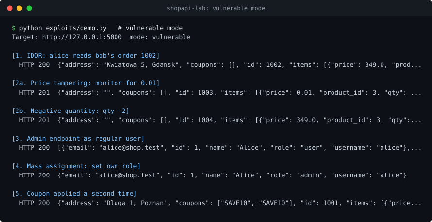
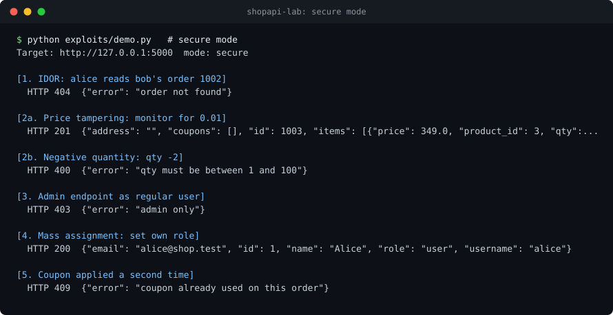

# shopapi-lab


A small online shop API with five deliberate authorization and business logic flaws, plus the same API with all fixes applied. It is a training target and a worked example of how these bugs are found, exploited and fixed.

> Intentionally vulnerable. Run it on localhost only and never expose it to a network.

Exploit run against the vulnerable mode:



The same requests against secure mode (`LAB_MODE=secure`):



## Flaws

| # | Flaw | OWASP API Top 10 2023 | Write-up |
|---|---|---|---|
| 1 | IDOR: read any user's order | API1 Broken Object Level Authorization | [01](docs/01-idor-orders.md) |
| 2 | Client-controlled price, negative quantity | API6 Sensitive Business Flows | [02](docs/02-price-tampering.md) |
| 3 | Admin endpoint open to regular users | API5 Broken Function Level Authorization | [03](docs/03-admin-endpoint.md) |
| 4 | Mass assignment: user sets own role | API3 Broken Object Property Level Authorization | [04](docs/04-mass-assignment.md) |
| 5 | Single-use coupon applied repeatedly | API6 Sensitive Business Flows | [05](docs/05-coupon-stacking.md) |

Each write-up has a summary, curl reproduction, impact, root cause, the fix, and how to find the same bug in a real test.

## Run

```bash
git clone https://github.com/Ernest-Kosmatko/ShopAPI-Lab.git
cd ShopAPI-Lab
pip install -r requirements.txt

python -m shopapi                    # vulnerable mode
LAB_MODE=secure python -m shopapi    # same API with fixes applied
```

On Windows PowerShell use `$env:LAB_MODE="secure"; python -m shopapi`.

Accounts: `alice` / `alice123`, `bob` / `bob123` (regular users), `admin` / `admin123`.

Run every exploit against the running server:

```bash
python exploits/demo.py
```

## Endpoints

| Method | Path | Purpose |
|---|---|---|
| POST | `/api/login` | Returns a bearer token |
| GET | `/api/orders`, `/api/orders/{id}` | Own orders, single order |
| POST | `/api/orders` | Create an order |
| POST | `/api/orders/{id}/coupon` | Apply a coupon |
| PATCH | `/api/profile` | Update own profile |
| GET | `/api/admin/users` | List all users |

## Tests

```bash
pip install -r requirements-dev.txt
pytest
```

Every flaw is exploited against the vulnerable app and must fail against the secure one, so the tests prove both that the bug is real and that the fix works.

## Automated testing

[authmatrix](https://github.com/Ernest-Kosmatko/authmatrix) is an authorization tester that finds all five flaw classes here in vulnerable mode and reports nothing in secure mode.

## Notes

- State is in memory and resets on restart
- Passwords are stored in plain text on purpose to keep the lab small; do not copy that into real code
- Rate limiting, input schemas and logging are left out so the flaws stay in focus

## License

MIT
